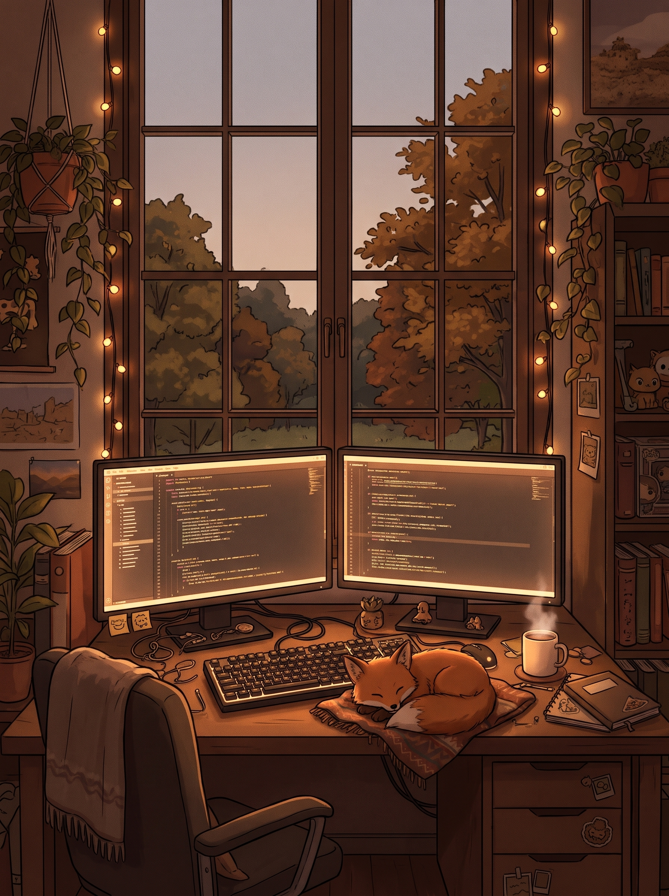

<div align="right">
  <a href="./README.md">
    
  </a>
  <a href="./README.ru.md">
    
  </a>
</div>

<div align="center">
  
</div>

<!-- If you prefer an animated SVG wave instead of banner.jpg, uncomment the block below: -->
<!--
<div align="center">
  
</div>
-->

<div align="center">
  <a href="https://git.io/typing-svg">
    
  </a>
</div>

---

## 🎯 About Me

<table>
  <tr>
    <td width="62%" valign="top">

- 🔭 **Status:** Open to exciting projects, hackathons & collaborations
- 🌱 **Currently focusing on:** React/TypeScript ecosystems, FastAPI backends & ML pipelines
- 💬 **Ask me about:** Frontend architecture, interactive UI animations, Python bots & Data Science
- ⚡ **Fun fact:** *99 little bugs in the code, take one down, patch it around, 127 little bugs in the code* 🐛

```ts
const foxy = {
  name: "Светлана",
  handle: "Svetlana-B-V",
  role: "Fullstack-разработчица | Исследователь ИИ и ML",
  building: [
    "Интерактивные веб-приложения и дашборды",
    "Умные боты и быстрые REST API",
    "Пайплайны анализа данных и ML"
  ],
  tech: {
    frontend: ["React", "TypeScript", "JavaScript", "TailwindCSS", "HTML/CSS"],
    backend: ["Python", "FastAPI", "PHP"],
    dataScience: ["Pandas", "NumPy", "Scikit-Learn", "CatBoost", "Matplotlib"]
  }
};
```

> *"Clean code always looks like it was written by someone who cares — especially when paired with a warm cup of coffee and great UI."*

</td>
    <td width="38%" valign="middle" align="center">
      
    </td>
  </tr>
</table>

---

## 📫 Connect With Me

<div align="left">
  <a href="https://t.me/YOUR_TELEGRAM" target="_blank">
    
  </a>
  <a href="https://gitverse.ru/YOUR_GITVERSE" target="_blank">
    
  </a>
  <a href="https://github.com/Svetlana-B-V" target="_blank">
    
  </a>
  <a href="mailto:YOUR_EMAIL@gmail.com">
    
  </a>
</div>

---

## 🛠️ Tech Stack

<div align="left">
  
</div>

<br/>

<div align="left">
  
  
  
  
  
  
  
  
  
  
</div>

---

## 🏆 Featured Projects & Highlights

- 🚀 **[alphaHak](https://github.com/Svetlana-B-V/alphaHak)** `(TypeScript ★ 2)` — Interactive hackathon frontend dashboard featuring modular layouts, custom particle effects, and dynamic visual animations.
- 🏛️ **[siteForUniversity](https://github.com/Svetlana-B-V/siteForUniversity)** `(JavaScript)` — Modern university web portal prototype crafted with responsive Bento-grid architecture, intuitive navigation, and interactive user flows.
- ✅ **[MyToDoList](https://github.com/Svetlana-B-V/MyToDoList)** `(CSS / Web)` — Clean, aesthetic task management application focused on daily productivity, smooth micro-interactions, and custom styling.

### 🛠️ Development Focus
`Frontend Engineering` · `React & TypeScript` · `Interactive UI/UX` · `Python & FastAPI` · `Machine Learning`

---

## 📊 GitHub Analytics

<div align="center">
  
</div>

<div align="center">
  
  
</div>

<div align="center">
  
  
</div>

---

## 🏆 GitHub Trophies

<div align="center">
  
</div>

<div align="center">
  
</div>
