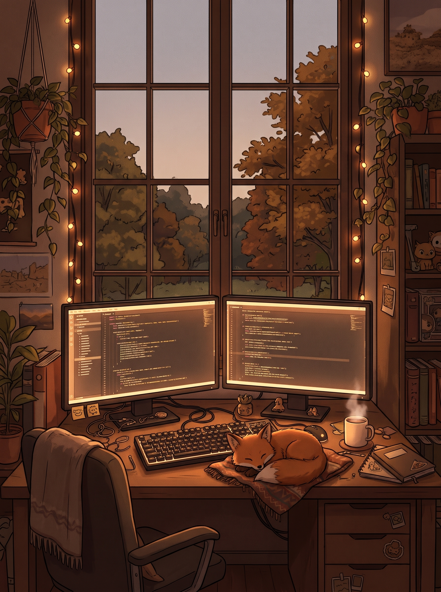

<div align="right">
  <a href="./README.md">
    
  </a>
  <a href="./README.ru.md">
    
  </a>
</div>

<div align="center">
  
</div>

<div align="center">
  <a href="https://git.io/typing-svg">
    
  </a>
</div>

---

## 🎯 Обо мне



<div align="left">
  
  
</div>

- 🔭 **Сейчас создаю:** Интерактивные веб-дашборды, умных ботов и ML-модели
- 🌱 **Углубляюсь в:** Экосистему React/TypeScript и архитектуру на FastAPI
- 💬 **Сфера интересов:** Фронтенд-разработка, микроанимации UI, Python и Data Science
- ⚡ **Забавный факт:** *99 багов в коде, один исправили — осталось ещё 127 :)* 🐛

```tsx
// 🦊 foxy.config.ts — Конфигурация профиля разработчика
interface FoxyDeveloper {
  readonly name: string;
  readonly handle: "@Svetlana-B-V";
  role: string[];
  stack: Record<"frontend" | "backend" | "dataScience", string[]>;
  currentQuest: string;
}

export const foxy: FoxyDeveloper = {
  name: "Светлана",
  handle: "@Svetlana-B-V",
  role: ["Fullstack-разработчица", "UI/UX энтузиаст", "Исследователь ИИ и ML"],
  stack: {
    frontend: ["React", "TypeScript", "JavaScript", "TailwindCSS"],
    backend:  ["Python", "FastAPI", "PHP", "REST API"],
    dataScience: ["Pandas", "NumPy", "Scikit-Learn", "CatBoost"]
  },
  currentQuest: "Превращаю сложные идеи в эстетичные и быстрые веб-приложения ✨"
};
```

> 💬 *«Чистый код всегда выглядит так, будто его написал человек, которому не всё равно — особенно в сочетании с продуманным UI и чашкой тёплого кофе».*

<br clear="both"/>

---

## 📫 Связаться со мной

<div align="left">
  <a href="https://t.me/YOUR_TELEGRAM" target="_blank">
    
  </a>
  <a href="https://gitverse.ru/YOUR_GITVERSE" target="_blank">
    
  </a>
  <a href="https://github.com/Svetlana-B-V" target="_blank">
    
  </a>
  <a href="mailto:YOUR_EMAIL@gmail.com">
    
  </a>
</div>

---

## 🛠️ Технологический стек

<div align="left">
  
</div>

<br/>

<div align="left">
  
  
  
  
  
  
  
  
  
  
</div>

---

## 🏆 Избранные проекты

- 🚀 **[alphaHak](https://github.com/Svetlana-B-V/alphaHak)** `(TypeScript ★ 2)` — Интерактивный фронтенд-дашборд для хакатона с нестандартной модульной сеткой, анимацией частиц и динамическим фоном.
- 🏛️ **[siteForUniversity](https://github.com/Svetlana-B-V/siteForUniversity)** `(JavaScript)` — Современный концепт университетского портала с Bento-сеткой, ролевыми дашбордами и продуманной навигацией.
- ✅ **[MyToDoList](https://github.com/Svetlana-B-V/MyToDoList)** `(CSS / Web)` — Эстетичный планировщик задач с кастомной стилизацией и удобным интерфейсом для ежедневной продуктивности.

### 🛠️ Ключевые направления
`Frontend-разработка` · `React & TypeScript` · `Интерактивный UI/UX` · `Python & FastAPI` · `Machine Learning`

---

## 📊 Аналитика и статистика GitHub

<div align="center">
  
</div>

<div align="center">
  
  
</div>

<div align="center">
  
  
</div>

---

## 🏆 Достижения и активность

<div align="center">
  
  
  
  
</div>

<br/>

<div align="center">
  
</div>

<div align="center">
  
</div>
